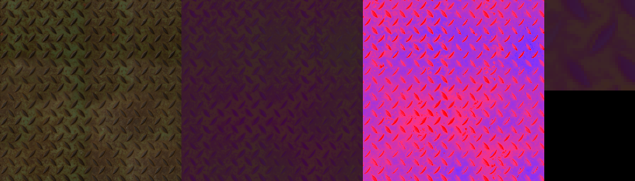
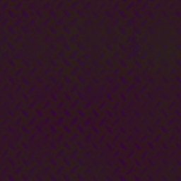
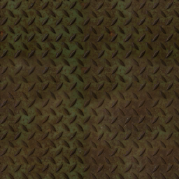
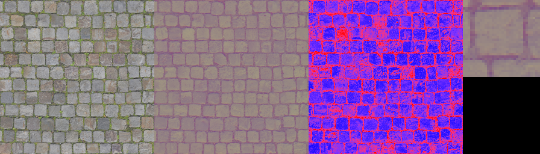

# ntc

NTC1 stores one PBR material as quantized latent grids plus an MLP of integer weights, and decodes each texel with portable fp32 dots in Vulkan 1.3 and OpenGL 4.5.

The container is not NVIDIA NTEX. RTXNTC is not vendored. Official `ntc-cli` numbers are pending a machine that can run it.

## Format

Little-endian. Magic `0x3143544E` (`NTC1`). Version 1. Header 96 bytes. `crc32` is zlib CRC-32 of every byte after the header.

| offset | type | field |
| --- | --- | --- |
| 0 | u32 | magic |
| 4 | u16 | version |
| 6 | u16 | header_bytes = 96 |
| 8 | u32 | flags |
| 12 | u32 | width |
| 16 | u32 | height |
| 20 | u16 | channels |
| 22 | u16 | num_mips |
| 24 | u16 | grids |
| 26 | u16 | layers |
| 28 | u16 | activation |
| 30 | u16 | pe_mode |
| 32 | u16 | pe_octaves |
| 34 | u16 | weight_bits |
| 36 | u16 | group_size |
| 38 | u16 | tile_size. 0 is one fp16 scale per latent channel. Nonzero is a Python-only per-tile endpoint map. The C++ reader throws if it is not 0. |
| 40 | u32 | channel_off |
| 44 | u32 | grid_off |
| 48 | u32 | layer_off |
| 52 | u32 | latent_off |
| 56 | u32 | latent_bytes |
| 60 | u32 | weight_off |
| 64 | u32 | weight_bytes |
| 68 | u32 | scale_off |
| 72 | u32 | scale_bytes |
| 76 | u32 | crc32 |
| 80 | u32 | file_bytes |
| 84 | u32 | plain latent bytes when flag bit 2, 3, or 5 is set, otherwise 0 |
| 88 | u64 | reserved |

Flag bit 0: derived mips (set on every file this encoder writes). Flag bit 1: activation requant. It is off in shipped files. Flag bit 2: the latent region is a raw deflate stream (`wbits = -15`, no zlib wrapper). Flag bit 3: the same plain bytes coded with an order-1 adaptive range coder over nibbles (low nibble first, 16 contexts, counts start at 1, rescale at 4096). Flag bit 5: the same plain bytes coded with a 256-context range coder. The context is the previous nibble, the top two bits of the previous byte, and one of four bands along the concatenated latent (`min(3, index * 4 / length)`). At most one of bits 2, 3, and 5 is set. Grid `data_off` values are then relative to the inflated bytes. `total_bpp` counts the compressed length. The GPU upload inflates first and appends derived mips, so the shader never reads the compressed stream. The inflated size is the inference working set. `latent_coder = best` writes whichever of deflate and the order-1 range coder is smaller. It does not set bit 5, so a `train_max` file stays on those two coders. `latent_coder = context` sets bit 5. `latent_coder = best_all` writes the smallest of the three streams.

Channel record, 8 bytes: `u8 semantic, u8 color_space, u16 reserved, u32 reserved`.

| semantic | name |
| --- | --- |
| 0..2 | albedo r, g, b |
| 3..5 | normal x, y, z |
| 6 | roughness |
| 7 | metalness |
| 8 | ao |
| 9 | height |
| 10 | opacity |
| 11 | extra |

Grid record, 24 bytes: `u16 width, u16 height, u8 channels, u8 bits, u16 row_stride, u32 data_off, u32 data_bytes, u32 scale_off, u32 plane_bytes`.

Layer record, 32 bytes: `u16 in, u16 out, u32 weight_off, u32 weight_bytes, u32 bias_off, u32 scale_off, u16 group_size, u16 num_groups, u32 weight_bits, u32 reserved`. `weight_bits == 0` means the header value. A mixed int8/int4 file stores 8 or 4 per matrix. Old files have 0 there and still decode.

Limits: 8 grids, 4 layers, 16 channels, hidden width 64, 160 input features, 8 mips.

Four rates are reported on every encode. `total_bpp` is the historical one and is unchanged: `8 * payload / (width * height)`, where payload is packed latent codes + fp16 latent scales + integer weights + fp16 bias + fp16 weight scales. The header and the descriptor tables are not in it. The denominator is mip 0 only, and the count is not divided by the channel count. Do not put `total_bpp` next to an RTXNTC `--bitsPerPixel` number or a paper bppc number.

`latent_bpp_mip0` is the SDK rate. It is `8 * (stored latent codes + fp16 latent scales) / (width * height)`. Weights, bias, weight scales, the header, and the descriptor tables are excluded. `ntc-cli --bitsPerPixel` selects a latent grid at this kind of rate. `rate="latent"` in `TrainConfig` selects our grids against this number. The default `rate="payload"` still selects against `total_bpp`.

`file_bpp_chain` is `8 * file_bytes / mip_chain_texels`. The numerator is the whole file. The denominator is every mip the header declares (`num_mips`, a full chain is `floor(log2(max(width, height))) + 1` levels down to 1x1). Derived color mips are not stored a second time.

`bppc` is the paper rate: `8 * payload / (mip_chain_texels * channels)`. Payload is the same numerator as `total_bpp`. Vaidyanathan et al. 2023 Table 3 reports bits/pixel/channel including mips and weights, as a 20-material average: 0.23 -> 32.71 dB, 0.56 -> 36.12, 1.13 -> 39.92, 2.51 -> 45.30. Those points are a different material set, not a matched comparison.

`header_bytes` is 96. One header covers the material and every mip in the chain. `network_bytes` is the integer MLP weights plus the fp16 bias and the fp16 weight scales. It is inside `total_bpp` and `bppc`, and it is outside `latent_bpp_mip0`. The header layout is unchanged.

## Network

Input features are the concatenated bilinear latent samples, then optional positional features. `pe_mode` 0 produces none. Mode 1 (Fourier) produces `4 * octaves` values, `sin/cos(2π * uv * 2^o)` on each axis, with `uv` not doubled. Mode 2 (triangle) produces `4 * octaves + 2` values, the second pair being `lod = mip / (num_mips - 1)` duplicated. Shipped files use mode 0.

The MLP is a stack of affine layers. Hidden activation 0 is identity, 1 is ReLU, 2 is the hard GELU `min(x, 3) * saturate(x / 3 + 0.5)`. Shipped files use ReLU. The last layer has no activation. Output channels follow the channel table order.

A shipped high-rate network for a 9-channel material is:

| item | value |
| --- | --- |
| grids | 256x256x4 at 4 bits, then 8x8x2 at 2 bits |
| MLP | 6 to 32 ReLU, 32 to 9 |
| weights | int8, one fp16 scale per output row |
| MACs, one MLP | 480 |
| position features | 0 |

The low-rate search may pick other grids. The decoder does not assume this shape.

## Latent grids and addressing

Codes are planar, channel-major, row-major. Row stride is `(width * bits + 7) / 8` bytes.

| bits | packing |
| --- | --- |
| 8 | one code per byte |
| 4 | even x in bits 3:0, odd x in bits 7:4. Width even. |
| 2 | `x % 4 == k` in bits `2k+1:2k`. Width multiple of 4. |

Only mip 0 is stored. Mip `k+1` is a 2x2 integer box of mip `k`: `(a + b + c + d + 2) / 4`. A size-1 axis uses `(sum + 1) / 2`. Odd trailing rows and columns are dropped. `num_mips` is `min(8, floor(log2(max(width, height))) + 1)`. The GPU upload appends the packed derived mips after the file bytes and 4-byte-pads the blob. Descriptor mip offsets point into that blob.

For the 16.084 bpp metal_plate network the stored latent payload is 131104 bytes and the derived chain is 43702 bytes. Those 43702 bytes are computed at upload and are not in the file. A stored chain would add that many bytes, about one third of the stored latent payload (`43702 / 131104`).

Bilinear sample of one grid at `uv` in `[0, 1]`:

```
x = u * W - 0.5
y = v * H - 0.5
x0 = floor(x), y0 = floor(y)
tx = x - x0, ty = y - y0
```

Corners wrap with floor-mod. The four codes are lerped in x, then in y. The affine dequant runs once on the lerped code, which is exact because dequant is affine:

```
value = (lerped - mid) * scale
mid = (2^bits - 1) / 2
```

`scale` is one fp16 value per latent channel, for the whole grid.

## Quantization

Latent parameters are trained in code units. With straight-through estimation:

```
q = round(z) clamped to [0, 2^bits - 1]
q_ste = z + (q - z).detach()
deq = (q_ste - mid) * scale
```

Weight codes are signed and symmetric. int8 uses `[-127, 127]`. int4 uses `[-7, 7]`. The extreme negative bin is unused. A group is a contiguous span of the input axis of one output row. `group_size == 0` is one scale for the whole row. Scales and biases are stored as fp16 and the training quantizer rounds them to fp16 before the forward pass.

```
acc = sum_i float(w[i]) * x[i]
y = bias + scale * acc
```

This is the per-group scale, round-to-nearest, clamp scheme described by cvs0/weight-quantizer. That repository documents the method. The implementation here is `src/ntc/quant.py` and `cpp/include/ntc/group_quant.hpp`.

`third_party/expcode` is the bf16 exponent codec from cvs0/bf16-exponent-gemv (MIT). It is not on the decode path. On three random normal matrices it was larger than int8: 32x8 was 596 bytes vs 256, 9x32 was 552 vs 288, 64x48 was 4948 vs 3072. It beat raw bf16 only on the 64x48 matrix (4948 vs 6144).

## Shader decode and cost

`shaders/ntc_decode.glsl` is the library. Vulkan bindings use `set = 0`. OpenGL bindings omit the set. `NTC_FP16` accumulates the dot in float16 and is not bit-exact. `NTC_NO_OUT` skips the output buffer.

Descriptor, 84 `uvec4`s, written by `ntc::make_gpu_upload`:

| index | contents |
| --- | --- |
| 0 | width, height, channels, grids |
| 1 | layers, activation, pe_mode, pe_octaves |
| 2 | flags, weight_bits, num_mips, frame |
| 3 | filter_mode, max_aniso, 8, 0 |
| 4..11 | grid channels, bits, scale_offset, nmips |
| 12..15 | layer in, out, weight_offset, bias_offset |
| 16..19 | layer scale_offset, group_size, num_groups, weight_bits |
| 20..83 | mip `g * 8 + k`: data_offset, row_stride, width, height |

Required arithmetic is fp32 dots of the integer weights. `GL_EXT_shader_integer_dot_product` is not used: this tree's glslang does not compile it. `VK_KHR_cooperative_matrix` is queried and not used, because one texel's GEMV does not fill a tile. Subgroup size is read from the device. The shader does not assume 32 or 64.

Filter modes:

| mode | name | MLP evals |
| --- | --- | --- |
| 0 | point | 1 |
| 1 | feature bilinear | 1 |
| 2 | color bilinear | 4 |
| 3 | stochastic | 1 |
| 4 | feature trilinear | 2 |
| 5 | stochastic anisotropic | N |

Mode 1 is the latent lerp above, then one MLP. Mode 2 evaluates the MLP at the four texel centers and lerps the colors. Mode 4 lerps two feature-bilinear colors by `fract(lod)`. Mode 3 picks one of the four corners. The hash is `uint(x) * 1664525 + uint(y) * 1013904223 + frame * 22695477`, then the low 24 bits over `2^24`. Corner probabilities are the bilinear weights, in order `(x0,y0), (x1,y0), (x0,y1), (x1,y1)`. Mode 5 takes `N = clamp(ceil(major/minor), 1, max_aniso)` samples along the major screen-space derivative and averages stochastic corners. Tap `i` mixes `frame + i * 747796405`.

Flops for one feature-bilinear sample, counted as scalar adds and multiplies:

| term | count |
| --- | --- |
| code lerp | 6 per latent channel |
| dequant | 2 per latent channel |
| weight dot | 2 per MAC |
| bias and scale | 2 per layer output |
| ReLU | 1 per hidden unit |
| hard GELU | 4 per hidden unit |

Latent bytes are an upper bound of 4 taps times channels, one packed byte per tap per channel. A 4-bit or 2-bit pair that shares a byte is also reported as `latent_bytes_shared_x`. Weight bytes are the cold MLP working set. A workgroup that holds the weights once divides that by the number of invocations.

Shipped 16.084 bpp network, one feature-bilinear texel:

| quantity | value |
| --- | --- |
| MACs | 480 |
| flops | 1122 |
| latent bytes, upper | 24 |
| latent bytes, shared-x bound | 12 |
| weight bytes, cold | 644 |
| weight bytes if shared by 64 invocations | 10.0625 |
| unique latent bytes in an 8x8 tile | 2.9375 per texel |
| same tile, no reuse | 24 per texel |

Color bilinear multiplies the MLP term by 4 (1920 MACs, 4488 flops). Feature trilinear multiplies it by 2. The sample pass used by `run_all` is one thread per output pixel and does not stage the tile. `load_fp32_stage` and `load_fp16_stage` are the staged load dispatches. The RX 9070 report below is from c33648b, before those two rows existed.

Baking the per-channel latent scale into the first int8 matrix is not exact: the scale is fp16 and the stored weights are integer. The dequant is 12 flops and 12 scale bytes on this network, next to 960 dot flops. It was not implemented.

## Filtering checks

Reference implementation: `src/ntc/decode_ref.py`. Same hash and same corner order as the shader. Measured on one 8x8 random network, seed 2 (`results/filtering.json`):

| check | result |
| --- | --- |
| mean of 400 stochastic frames vs color bilinear | max abs 9.774e-6 |
| feature trilinear vs a manual lerp | max abs 0 |
| deterministic aniso vs the mean of the same taps | max abs 0, N = 5 |
| mean of 300 stochastic-aniso frames vs color-bilinear at those offsets | max abs 2.466e-6 |
| corner rate minus expected weight, 4000 samples | -0.00454, -0.00140, +0.00566, +0.00028 |

## Vulkan and OpenGL

```cpp
ntc::TextureSet ts = ntc::load_file(path);
ntc::GpuUpload up = ntc::make_gpu_upload(ts, frame, ntc::kFilterFeatureBilinear, 8);
// up.desc: 84 uvec4. up.blob: file bytes, then packed derived mips.
```

Compute, one thread per texel:

```glsl
vec2 uv = (vec2(gl_GlobalInvocationID.xy) + vec2(0.5)) / vec2(float(W), float(H));
ntc_eval(uv, mip);
```

Filtered sampling:

```glsl
ntc_eval_filtered(uv, dudx, dudy, lod, frame, /*filt*/ 1u, /*maxAniso*/ 8u);
```

`examples/vulkan/main.cpp`: `ntc_vk file.ntc spv_dir [--device index|name] [--bench outdir] [--warmup N] [--iters N] [--bc7 file] [--bc1 file] [--bc5 file]`. Prints `device_count`, one `device_list` line per physical device (index, name, vendor, device id, type), then the selected device's name, vendor id, device id, raw driver version, API version, and subgroup size. Selection is the integer index or a case-insensitive name substring when `--device` is set, otherwise discrete, then integrated, then CPU. The fp32 compute shader is compared to `ntc::decode_mip` with tolerance `1e-3`. If `shaderFloat16` is set, it also runs `ntc_decompress_fp16.comp`. Cooperative matrix is queried and ignored. `--bench` times inference-on-load (every mip) and inference-on-sample at the texture size, 1920x1080, and 3840x2160 with `vkCmdWriteTimestamp`, after warmup submits. Median and p95 are printed with texels/s and GB/s of the written output. A CPU device skips resolutions above 512 and tags every row `not_a_performance_claim`. Optional `--bc7`, `--bc1`, and `--bc5` are NTCB files (`bench/bc_pack.py`): sampled at the same resolutions. The host writes `vk_ntc_fp32.f32` and, when the file has at least six channels, `vk_lit_fp32.f32`.

`examples/opengl/main.cpp`: `ntc_gl file.ntc shader_src_dir` with the same `--bench`, `--warmup`, `--iters`, and block-file flags. Linux uses a surfaceless EGL context. Windows creates a hidden window and a core-profile WGL context (`wglCreateContextAttribsARB`, 4.6 then 4.5) and loads GL entry points with `wglGetProcAddress`. The host splices `ntc_decode.glsl` in, because the driver is not asked for `GL_GOOGLE_include_directive`. The GL vertex shader uses `gl_VertexID`. Fragment `uv` is `gl_FragCoord.xy / size` with no Y flip: GL and `glReadPixels` are both lower-left, and mip 0 row 0 is `v = 0.5 / H`. `--bench` uses `GL_TIME_ELAPSED`. The fp16 load path is compiled when the context advertises `GL_EXT_shader_explicit_arithmetic_types_float16`, `GL_EXT_shader_explicit_arithmetic_types`, `GL_AMD_gpu_shader_half_float`, or `GL_NV_gpu_shader5`, in that order. The extension that linked is printed as `fp16_ext`. If none is present, or the compile fails, the row is `load_fp16 skipped no_gl_fp16` or `skipped compile`. A renderer string containing llvmpipe, softpipe, or swiftshader is tagged `not_a_performance_claim` and skips resolutions above 512. Readbacks are `gl_ntc_fp32.f32` and `gl_lit_fp32.f32`.

CPU reference: `ntc_decode file.ntc out.f32 [--mip N]`.

Python: `ntc-encode MATERIAL OUT.ntc --size 256 --bpp 16`. `ntc-decode FILE OUT.npz --reference MATERIAL --size 256`.

## Compatibility

Required path: Vulkan 1.3 or OpenGL 4.5, storage buffers, fp32. No `GL_NV_*`, no `VK_NV_*`, no cooperative-matrix variant.

| vendor | API | mode | required | optional, queried |
| --- | --- | --- | --- | --- |
| AMD, NVIDIA, lavapipe, others | Vulkan 1.3 | inference-on-load compute | storage buffer, int8/fp32 | `shaderFloat16` selects the fp16 dot |
| same | Vulkan 1.3 | inference-on-sample | same, plus a fragment or compute dispatch | subgroup size is reported, not required |
| same | OpenGL 4.5 or 4.6 | compute and fragment | SSBO, GLSL 450 | `GL_KHR_shader_subgroup` is not required |

Subgroup size is whatever the device reports. This tree does not branch on 32 vs 64. A wave64 device runs the same fp32 dot.

Encoder device order for `auto`: CUDA, then ROCm, then DirectML, then CPU. CUDA and ROCm both report `torch.cuda`. A ROCm build sets `torch.version.hip` and still uses the `cuda` device API, including AMD's Windows ROCm wheels. `device_report` labels that backend `rocm` or `cuda`. DirectML is the `torch_directml` package (`privateuseone`); pass `--device directml` to force it. There is no CUDA-only op. This VM has the CPU wheel `2.14.1+cpu`.

RX 9070 is gfx1201. The Windows wheel that lists it is ROCm 7.2.1, torch 2.9.1, Python 3.12. AMD's install page names Adrenalin 26.2.2 as the driver for those wheels. A WDDM driver version such as `32.0.32015.7029` is a different numbering scheme; this tree does not claim they match. If `torch.cuda.is_available()` is false after the install, use the DirectML fallback. The commands are in `bench/train_sweep.ps1`. Do not install a separate torch into the DirectML venv first: current `torch-directml` 0.2.5.dev240914 pins `torch==2.4.1`.

## Encoder

`src/ntc/encode.py`. Latent grids are chosen from a family of one- and two-grid shapes, including full resolution (shift 0). The eight shapes closest to the target rate are scored at step 0 (PCA plus a least-squares last layer). The best is trained. For a hidden layer, four seeds are trained on that grid and the higher 8-bit PSNR is kept. Ranking seeds by the step-0 score, without training them, dropped the 8 bpp metal_plate point from 31.574 dB to 31.400 dB, so the pool trains each seed.

Initialization is coarse-to-fine PCA of the residual into each grid, then a least-squares fit of the last layer. Adam then runs for 40 steps at learning rate `5e-3` (latent parameters at `1e-2`) with a cosine decay to 5% of the base rate. After training, the export compares the initialization against the trained weights and keeps the higher 8-bit PSNR.

Loss is mean squared error. Channel weights and a normal-cosine term exist and are off by default.

Defaults: hidden `(32,)`, ReLU, no positional encoding, int8 weights, one scale per row, straight-through latent and weight quantization, `adaptive_pool = 8`, `seed_pool = 4`, 40 steps, `channel_weighting = false`, `latent_coder = best`, `rd_lambda = 0`, `target_psnr` unset, `mip_levels = 4`, `mip_loss = footprint` (weight `0.25**mip`). `geom` is `0.5**mip`. A curriculum that trains mip 0 for the first half of the steps was measured and not adopted. Per-tile latent endpoints (`tile_size > 0`) stay off: the C++ reader throws, and at a matched rate more Adam steps beat them. On the locked seed-3 metal network after 40 Adam steps (mip 0 loss, PSNR 35.7492), the plain latent is 131104 bytes. Deflate stores 79269 bytes (9.7565 bpp). The range coder stores 71365 bytes (8.7916 bpp). `best` selects the range stream. The C++ decoder matches the Python image to 2.98e-7 max abs on that file. A steps-0 PCA latent of the same grids is 78880 deflate bytes versus 71006 range bytes. On an artificial 64x64 grid of repeated 8x8 blocks, deflate is smaller (396 vs 1961), and `best` keeps deflate.

Weights are int8 with straight-through quantization while training (`qat_weights`, `weight_bits = 8`). That is the same int8 the packed decode path multiplies. Each latent channel has its own learned step, `exp(log_scales)`, stored as fp16 and clamped to `[1e-4, 5]`. The reconstructed value is `(code - mid) * scale`. `rd_lambda` defaults to 0, which leaves that loss graph unchanged. When it is positive, each step adds `rd_lambda * sum over channels of log2(1 + mean neighbor residual) * grid_texels / image_texels`. The residual is the absolute code step to the left texel and to the upper texel, and those neighbors are detached. A constant channel adds 0. The scale parameters are outside the rate term. `ntc-encode --rd-lambda` sets it. `bench/rd_curve.py --rd-lambdas` sweeps it. On a 32x32 image, fixed grids `32x32x2@4`, hidden 32, 40 steps, `best_all`: lambda 0 stored 346 latent bytes at 25.244 dB (entropy 3.545). Lambda `1e-2` stored 342 bytes at 25.647 dB (entropy 3.530). Lambda `0.1` stored 341 bytes at 25.223 dB. The saving on that image is 4 bytes.

`ntc-encode --target-psnr D` searches target rates 2, 4, 6, 8, 10, 12, 16, and 20 (plus `--bpp` when that value is outside the list). Each probe trains `search_steps` steps, or `min(20, --steps)` when `--search-steps` is 0, with `adaptive_pool = 1` and `seed_pool = 1`. The grid family is the one in `select_grids`: one and two grids, shifts 0 through 5, channel counts 2, 4, 8, and 12, latent bits 2, 4, and 8. The smallest file whose 8-bit PSNR meets D is then trained with the caller's step count and pool sizes. If no probe meets D, the highest PSNR is kept. The search stays off unless `--target-psnr` is set. `train_max` does not set it, and it does not set `rd_lambda`.

## Measurements

Machine: Linux 6.12.94+, x86_64, glibc 2.39, torch 2.14.1+cpu, 4 threads. No GPU. Every quality number below is from a run on that machine. JSON in `results/` holds the unrounded values.

PSNR is `10 log10(1 / mse)` after `round(clip(x, 0, 1) * 255) / 255`, capped at 100. SSIM is Wang 2004, 11x11 Gaussian, sigma 1.5, `k1 = 0.01`, `k2 = 0.03`, on those 8-bit values. FLIP is not installed. `try_flip` returns nothing here.

Block codecs on metal_plate resized to 256 with a box filter. BC7 is `bc7enc -l -u4`. The 16 bpp bundle is BC1 albedo, BC5 normal, BC1 of roughness/metalness/ao, `bc7enc -1/-5 -u5`, normal Z reconstructed from XY. ASTC is `astcenc 5.7.0 -cl -medium`.

| codec | bpp | PSNR | SSIM |
| --- | --- | --- | --- |
| NTC1, target 4 | 4.076 | 28.479 | 0.7737 |
| NTC1, target 8 | 8.080 | 31.574 | 0.8523 |
| NTC1, target 10 | 10.080 | 32.174 | 0.8532 |
| NTC1, target 12 | 12.072 | 32.260 | 0.8645 |
| NTC1, target 16 | 16.084 | 35.749 | 0.9474 |
| NTC1 linear, target 16 | 16.016 | 34.391 | 0.9181 |
| BC1+BC5+BC1 | 16.000 | 33.199 | 0.9258 |
| ASTC 8x8, five textures | 10.000 | 34.072 | 0.9282 |
| ASTC 6x6, five textures | 17.778 | 38.275 | 0.9647 |
| ASTC 4x4, five textures | 40.000 | 45.794 | 0.9906 |
| BC7, five textures | 40.000 | 44.867 | 0.9900 |

Chart: `results/rd_metal_plate_256.png`.

At 16.084 bpp the network from the table above is grids `256x256x4@4` and `8x8x2@2`, hidden 32, seed 3, 480 MACs, 1122 flops, plain latents, mip 0 loss. Per-channel 8-bit PSNR: albedo 37.018, normal 39.459, roughness 37.525, metalness 31.595, ao 32.293. Normal angle 1.769 degrees. Against the 16 bpp block bundle that is +2.550 dB PSNR and +0.0216 SSIM. It does not beat ASTC 6x6 (38.275 dB at 17.778 bpp) or per-texture BC7 (44.867 dB at 40 bpp). The dedicated 10 bpp grids do not beat ASTC 8x8 (32.174 vs 34.072). Deflate of that same 16 bpp file is a different rate point and is in the next section.

The linear network on the same grids keeps the PCA initialization (40 Adam steps scored 34.348 dB and were discarded). 54 MACs, 174 flops, 90 weight bytes. It is +1.192 dB PSNR over the 16 bpp bundle and -0.0077 SSIM.

Half-resolution family, hidden 32, channel weighting on, 40 steps, same material (`results/rd_metal_plate_256.json`): 30.734 dB at 16.105 bpp, SSIM 0.8960, grids no larger than 128. The shipped point is +5.015 dB and +0.0514 SSIM at the same rate. That gap is not one factor. The isolated factors are below.

metal_plate 16 bpp, one encode, this CPU (`results/encode_time_metal16.json`): wall 8.833 s, of which the four trained seeds sum to 2.309 s and the winning seed is 0.506 s. The rest is the eight step-0 grid probes, export, and SSIM. CUDA and ROCm encode times are pending hardware.

PavingStones070 resized to 256, same encoder. The material has albedo, normal, roughness, ao, and height, and no metalness.

| codec | bpp | PSNR | SSIM |
| --- | --- | --- | --- |
| NTC1, target 8 | 8.076 | 28.109 | 0.8242 |
| NTC1, target 16 | 16.084 | 31.688 | 0.9117 |
| ASTC 8x8, five textures | 10.000 | 30.981 | 0.8840 |
| ASTC 6x6, five textures | 17.778 | 33.727 | 0.9368 |
| ASTC 4x4, five textures | 40.000 | 38.766 | 0.9802 |
| BC7, five textures | 40.000 | 37.604 | 0.9727 |
| BC1+BC5+BC1, height left at 0 | 16.000 | 12.840 | 0.8079 |

The bundle aggregate is not a matched-channel score: height is 3.382 dB because the bundle does not store it. On the eight channels the bundle writes, mean-square PSNR is 29.481 dB for the bundle and 32.139 dB for NTC1. NTC1 also stores height at 29.159 dB inside the same 16.084 bpp. Per group, NTC1 albedo is 31.449 vs the bundle's 32.659, NTC1 normal is 32.298 vs 26.513 (the bundle's reconstructed Z is 21.834 dB), and NTC1 roughness is 33.382 vs 34.677.

### Isolated deltas

Locked grids `64x64x4@2` and `16x16x12@8`, metal_plate 128, 40 steps, hidden 32, weighting on, seed 0, one seed (`results/ablation_locked_128.json`). Baseline 26.584 dB, SSIM 0.7536, 3.986 bpp, 800 MACs.

| change | PSNR | delta vs baseline |
| --- | --- | --- |
| PCA off | 21.122 | -5.462 |
| latent QAT off | 24.431 | -2.153 |
| uniform-noise proxy instead of STE | 26.143 | -0.442 |
| weighting off | 27.062 | +0.478 overall, normal 31.055 vs 31.790, angle 4.504 vs 4.006 degrees |
| Fourier, 1 octave | 26.299 | -0.285, 928 MACs, 4.049 bpp |
| triangle, 3 octaves | 24.793 | -1.792, 1248 MACs, 4.205 bpp |
| linear readout | 26.600 | +0.016, 3.604 bpp, 144 MACs, 434 flops |
| hidden 16 | 26.462 | -0.123, 400 MACs |
| hidden 48 | 27.158 | +0.573 at 4.213 bpp, 1200 MACs |
| hidden 64-32 | 23.509 | -3.075, 5.361 bpp, 3360 MACs |
| hard GELU | 26.583 | -0.002 |
| hard GELU plus activation requant | 11.363 | -15.221 |
| int4, group 16 | 26.008 | -0.576, 3.800 bpp |
| int8, group 16 | 26.677 | +0.092, 3.995 bpp |
| joint loss on 4 mips | 25.975 | -0.609 at mip 0, mip 2 26.057 vs baseline derived mip 2 of 23.045 |
| 0 Adam steps | 26.139 | -0.445 |

Grid search, not a same-grid ablation (`results/ablation_metal_plate_128.json`): the single closest shape at target 4 bpp scored 24.083 dB (1056 MACs). Scoring a pool of 4 and keeping the best scored 27.155 dB at 3.986 bpp (800 MACs), grids `64x64x4@2` and `16x16x12@8`. Delta +3.072 dB.

Full-resolution grids and the wider pool, metal_plate 256, target 16, hidden 32, weighting off:

| configuration | bpp | PSNR | SSIM | MACs |
| --- | --- | --- | --- | --- |
| half-resolution family, weighting on | 16.105 | 30.734 | 0.8960 | see `rd_metal_plate_256.json` |
| winning grids, linear, init kept | 16.016 | 34.391 | 0.9181 | 54 |
| winning grids, hidden 32, seed 0, 40 steps | 16.084 | 35.240 | 0.9331 | 480 |
| same, 80 steps, seed 0 | 16.084 | 35.354 | 0.9370 | 480 |
| same, seed 0, channel weighting on | 16.084 | 34.614 | 0.9254 | 480 |
| shipped: pool 8, four trained seeds, seed 3 | 16.084 | 35.749 | 0.9474 | 480 |

Seed 0 to the four-seed pool on those grids is +0.509 dB and +0.0143 SSIM. The other seeds scored 35.306, 35.287, and 35.240. Eighty steps on seed 0 gained +0.114 dB over forty steps (0.933 s vs 0.468 s of that seed) and still lost to seed 3 at forty steps. Weighting on lost 0.626 dB and 0.0076 SSIM against seed 0 unweighted.

Same-grid hidden 32 vs linear at seed 0 is +0.849 dB and +0.0150 SSIM for 480 MACs instead of 54. The shipped seed is a further +0.509 dB on the hidden network. The linear result does not depend on the hidden-layer seed.

### Deflate and footprint mips

Same machine, torch 2.14.1+cpu. `results/round2_vm.json` is a locked-grid ablation: metal_plate 256, grids `256x256x4@4` and `8x8x2@2`, hidden 32, seed 3, weighting off, one seed. `results/rd_round2.json` is the automatic selector with deflate and footprint loss on, pool 8, four trained seeds, 40 steps. Chart: `results/rd_metal_plate_256.png` plots both NTC series. Block-codec rows were not recomputed.

Raw deflate (`level 9`, `wbits -15`) does not change the decoded image. On the locked 40-step network, plain bpp 16.084 becomes 9.756 at the same 35.749 dB. PavingStones070 on the same grids goes from 16.084 bpp to 9.094 bpp at the same 31.688 dB. The inflated latent is 131104 bytes in both files. That is what the GPU upload expands.

Footprint loss on four mips, same locked metal network, 40 steps: mip 0 35.892 dB (+0.143 vs the mip-0-only 35.749), mip 1 35.254 vs 34.843, mip 2 34.382 vs 33.920. Deflate of that file is 9.760 bpp at the same 35.892 dB. The automatic selector picks the same grids and seed 3: `results/rd_round2.json` metal target 16 is 35.892 dB, SSIM 0.9499, 9.760 bpp. Paving target 16 is 31.693 dB, SSIM 0.9096, 9.113 bpp, seed 0.

Those two operating points beat ASTC 8x8 (metal 34.072 dB at 10.000 bpp, paving 30.981 dB at 10.000 bpp) on rate and on PSNR. They do not beat ASTC 6x6 (metal 38.275 dB at 17.778 bpp, paving 33.727 dB at 17.778 bpp).

More Adam steps on the locked metal grids, mip 0 loss, cosine decay already in the loop:

| steps | PSNR | deflate bpp | delta vs 40 steps | train seconds |
| --- | --- | --- | --- | --- |
| 40 | 35.749 | 9.756 | 0 | 0.74 |
| 80 | 36.137 | 9.820 | +0.388 | 1.10 |
| 160 | 36.140 | 9.904 | +0.391 | 2.31 |
| 320 | 36.446 | 10.123 | +0.697 | 4.58 |
| 800 | 37.049 | 10.517 | +1.299 | 10.71 |

The 320 to 800 step is still +0.603 dB. 37.049 is 1.226 dB under ASTC 6x6. The 2000 and 4000 step jobs were measured on the RX 9070. That table is below. Paving at 160 steps is 31.858 dB (+0.170) at deflate 9.455 bpp, still under ASTC 6x6.

Automatic selector, deflate and footprint, 40 steps (`results/rd_round2.json`):

| material | target | bpp | PSNR | SSIM | checkpoint |
| --- | --- | --- | --- | --- | --- |
| metal_plate | 4 | 3.603 | 28.389 | 0.7736 | trained |
| metal_plate | 8 | 5.594 | 31.621 | 0.8523 | trained |
| metal_plate | 10 | 7.340 | 32.168 | 0.8606 | init |
| metal_plate | 12 | 8.416 | 32.183 | 0.8660 | trained |
| metal_plate | 16 | 9.760 | 35.892 | 0.9499 | trained |
| metal_plate linear, target 16 | 16 | 9.703 | 34.627 | 0.9175 | trained |
| PavingStones070 | 8 | 4.672 | 28.120 | 0.8272 | trained |
| PavingStones070 | 10 | 6.463 | 29.366 | 0.8484 | trained |
| PavingStones070 | 16 | 9.113 | 31.693 | 0.9096 | trained |

The dedicated 10 bpp grids, deflated, are 32.168 dB at 7.340 bpp on metal and 29.366 dB at 6.463 bpp on paving. Both are under ASTC 8x8. The deflated 16 bpp network is the better point near 10 bpp.

## Negative results

Kept off, with the delta above:

- Uniform noise as a quantizer proxy. STE is higher.
- Fourier and triangle positional encoding. Both lost PSNR and added MACs.
- Hard GELU. No gain. Activation requant of the RTXNTC form (`round(z * 80 - 113)` to int8) fell to 11.363 dB.
- int4 weights. -0.576 dB on the locked 128 grid.
- int8 group size 16. +0.092 dB on that grid. The shipped linear and 32-wide nets use one scale per row. Group 16 was not adopted.
- Joint training of four mips. Mip 0 fell 0.609 dB. Mip 2 rose about 3.0 dB. Derived mips stay the format.
- Hidden 64-32 and the triangle-PE, hard-GELU, requantized 64-48-32 stack. The latter, trained here, scored 16.614 dB at 7.143 bpp and 6816 MACs on the locked 128 grids, and 18.030 dB at 4.006 bpp when the search gave it small grids. That stack is this encoder running a decoder shape from the RTXNTC paper. It is not `ntc-cli` output.
- Channel weighting and the normal-cosine term. On the 128 locked grid, weighting off raised overall PSNR 0.478 dB and SSIM, and lowered normal PSNR 0.734 dB. On the 256 winning grids at seed 0, weighting on scored 34.614 vs 35.240 unweighted. Normals are not separately protected in the default loss.
- Dedicating the finest grid's PCA to normals, or splitting normals and the other channels across grids (`results/shape_scan_256.json`). On the 16 bpp linear grids, normals-only fine PCA reached normal PSNR 40.47 and overall PSNR 30.53, against joint PCA at 30.92 normal and 33.28 overall. Roughness collapsed. Not adopted.
- A third grid. The best three-grid shape at step 0 was 33.310 dB at 16.021 bpp, against 33.276 dB for the two-grid linear init. SSIM was lower. The family stays at one or two grids.
- Training a linear map for 40 steps. On the winning grids the init is 34.391 dB and the trained weights are 34.348 dB. The export keeps the init.
- bf16 exponent coding of the weights, as above. Larger than int8 on the matrices that were measured.
- Fusing latent scales into the int8 matrix. Not exact. Not implemented.
- A subgroup or quad GEMV split of one texel. The MLP is 480 MACs. The shader stays one thread per texel. The 8x8 unique-byte count is analytical only.

Same locked 256 grids, seed 3, measured in `results/round2_vm.json`. Deltas are against the 40-step int8 ReLU mip-0 network at 35.749 dB unless a same-step comparison is named. None of these are the default.

- int4, one scale per row, QAT already on: 29.773 dB (-5.976). Group 16: 32.177 dB (-3.572). The same row quantizer at 160 steps is 31.971 dB against the 160-step int8 network at 36.140 dB (-4.169). The earlier -0.576 dB was the 128 locked grid. It does not carry to these grids. int4 stays off. The rate saving is about 0.03 bpp.
- Hidden 64-32. At 40 steps the export keeps the initialization, 34.801 dB (-0.948) at 16.389 bpp. At 160 steps, 34.820 dB against 36.140 dB for hidden 32. Mixed int8/int4/int8 on the three matrices of 64-32 stays on the initialization at 34.467 dB at 40 and at 160 steps.
- Fourier, 1 octave: 31.984 dB at 40 steps, 34.172 dB at 160 steps (against 36.140). Triangle, 3 octaves: 28.531 dB and 29.433 dB.
- Hard GELU: 35.561 dB at 40 steps (-0.188). At 160 steps, 36.036 dB against 36.140 for ReLU. Activation requant stays on the initialization at 33.978 dB at 40 and at 160 steps (-1.771).
- Third grid `256x256x4@4`, `64x64x2@4`, `8x8x2@2`: 35.316 dB at 40 steps (-0.434), 35.233 dB at 160 steps.
- Mip curriculum (footprint, mip 0 only for the first half of 40 steps): mip 0 35.683 dB (-0.066). Not adopted. `geom` weights on four mips are +0.060 dB at mip 0, less than footprint.
- Per-tile endpoints. Tile 32 at 40 steps is +0.184 dB at plain 16.208 bpp (deflate 9.896). Tile 16 at 40 steps is +0.263 dB at deflate 10.257 bpp. Tile 16 at 160 steps is 36.435 dB at deflate 10.450 bpp, under the 320-step untiled network (36.446 dB at deflate 10.123 bpp). The C++ reader rejects `tile_size != 0`, so these files are not on the GPU path.
- Paving tile 16 at 40 steps is 31.747 dB against 31.688 dB, at a higher bpp. Not adopted.
- Dedicated 10 bpp grids at 40 steps stay at 32.174 dB (deflate 7.393 bpp) on metal and 29.218 dB (deflate 6.505 bpp) on paving. 160 steps on metal reaches 32.251 dB. Still under ASTC 8x8.

## Correctness on this VM

CPU reference vs the Python decoder on `tests/fixtures/tiny.ntc`: max abs 1.490e-8 at mip 0 and 3.725e-9 at mip 1.

Lavapipe (Mesa 25.2.8, vendor `0x10005`, device type CPU, subgroup size 8, `shaderFloat16` and `shaderInt8` present, cooperative matrix absent) compute vs the CPU reference: max abs 0. The fp16 dot path: max abs 1.345e-4. `bench/gpu_bench.py` on this machine recorded a lavapipe timestamp of 1.277 ms (`results/gpu.json`). That is not a performance number.

OpenGL 4.5 llvmpipe, compute and fragment vs the CPU reference: max abs 0. `GL_KHR_shader_subgroup` is not present, so the reported subgroup size is 0. The 4.6 context request returns `EGL_BAD_MATCH`. The shaders are GLSL 450 and do not use a 4.6-only feature.

`pytest` covers the container, the quantizer, the reference decoder, filtering, and the cost model. `ctest` runs the C++ decoder against the fixture. glslang compiles the SPIR-V. CI is `.github/workflows/ci.yml`.

### RX 9070 training

`bench/train_sweep.ps1` on Windows 11, AMD Radeon RX 9070, ROCm 7.2.1, torch 2.9.1+rocm7.2.1, backend `rocm`. Wall times are the script's `wall` field. bpp is the deflate rate from that run (`latent_coder` was still deflate).

| job | PSNR | bpp | wall s |
| --- | --- | --- | --- |
| metal_g16_s800_mip0 | 36.1321 | 10.4712 | 15.0 |
| metal_g16_s2000_foot | 37.9472 | 10.9705 | 59.3 |
| metal_g16_s4000_foot | 38.8116 | 11.4863 | 118.1 |
| paving_g16_s2000_foot | 33.5768 | 11.2455 | 59.7 |
| paving_g16_s4000_foot | 33.9188 | 11.9886 | 119.3 |
| metal_g10_s2000_foot | 32.9017 | 7.6558 | 57.7 |
| paving_g10_s2000_foot | 29.9804 | 7.3474 | 58.4 |
| metal_pool8_s80_foot | 27.4268 | 14.1641 | 32.0 |

The 4000-step footprint metal point is 38.8116 dB at 11.4863 bpp. ASTC 6x6 on this material is 38.275 dB at 17.778 bpp. The paving 4000-step point is 33.9188 dB at 11.9886 bpp. ASTC 6x6 on paving is 33.727 dB at 17.778 bpp. The dedicated 10 bpp grids at 2000 steps are still under ASTC 8x8 on quality (metal 32.9017 vs 34.072, paving 29.9804 vs 30.981) at a lower rate. The 80-step pool of 8 picked a 14.164 bpp network at 27.4268 dB. That job is too short to rank grids.

The same 800-step mip-0 configuration on this CPU (torch 2.14.1+cpu) is 37.049 dB at deflate 10.517 bpp, train 10.71 s. The GPU result is 36.1321 dB, 0.917 dB lower, wall 15.0 s. The wall time is the same order as the CPU 800-step train, not the CPU 80-step train (1.10 s, 36.137 dB). The encoder did not seed the ROCm generator or disable TF32 on that run. Both are set now for `torch.cuda` devices. Whether that closes the 0.917 dB is not measured.

`bench/train_max.ps1` (and `bench/train_max.sh`) is the longer run. It downloads the extra CC0 set (`--preset max`: wood_floor, denim_fabric, aerial_rocks_01, forest_ground_04, plastered_wall, concrete_floor_02 at 1K, plus wood_floor and aerial_rocks_01 at 2K), probes 400 steps of fp32 against bf16 and keeps the higher PSNR for the rest, then runs seed pools and continuations. A job with a finished json is skipped. A `.pt` without a finished json is resumed. Output is `results/train_max/`. The printed `estimate_s` uses 118.1/4000 seconds per 256^2 step. 1024^2 full-frame steps scale by 16. The 2048 jobs sample 1024^2 pixels per step, so they also scale by 16. Early stop (8 evals, each 500 steps, without a 0.01 dB gain on the full-image 8-bit PSNR) can end a job earlier. Summing the planned steps at that rate is 2.94 hours before early stop. The script prints `estimate_s`. That figure is the extrapolation, not a completed run.

### Workgroup staging

`NTC_STAGE` in the compute shader copies the weight span and the latent rows touched by the 8x8 workgroup into shared memory, then the same `ntc_eval` reads them. `ntc_decompress_stage.comp` and `ntc_decompress_fp16_stage.comp`. On lavapipe, `stage_max_abs` is 0 for `tests/fixtures/tiny.ntc` and for the 256 range-coded metal file above. `fp16_stage_max_abs` matched the unstaged fp16 path: 0.000134453 on the fixture and 0.00292987 on that 256 file. `--bench` now times those shaders as `load_fp32_stage` and `load_fp16_stage` (one dispatch per mip, same output as `load_fp32`). The c33648b RX 9070 log does not have those rows.

## What is pending hardware

No GPU timing from this VM is a performance number. Lavapipe and llvmpipe rows are tagged `not_a_performance_claim` and the hosts skip 1920x1080 and 3840x2160 on a CPU device. Correctness on this VM is in the section above.

Training sweep, from the repository root. On Windows, install the torch build first (`bench/train_sweep.ps1` has the RX 9070 ROCm 7.2.1 commands and the DirectML fallback), then:

```powershell
powershell -ExecutionPolicy Bypass -File bench\train_sweep.ps1
```

Linux, including a machine that already has a CUDA or ROCm torch:

```sh
sh bench/train_sweep.sh
```

Writes `results/train_sweep/` (`device.json`, `manifest.json`, one `.json` and one `.ntc` per job). Copy that directory back. Jobs: locked 16 bpp grids at 800 steps with mip 0 loss (the CPU cross-check; this VM measured 37.049 dB and 10.71 s of train), the same grids at 2000 and 4000 steps with footprint loss for metal and paving, locked 10 bpp grids at 2000 steps for both materials, and one metal run with pool 8 and eight seeds at 80 steps. A finished `.json` is skipped on a second run. CPU scaling from the measured 40-step and 800-step times puts the sweep near 15 minutes of train on this 4-thread CPU. The GPU wall time is whatever `device.json` and the per-job `wall_s` fields say after the run.

Decode benchmark and screenshots:

```powershell
powershell -ExecutionPolicy Bypass -File bench\run_all.ps1
```

```sh
sh bench/run_all.sh
```

`run_all.sh` passes `--software` when `/dev/dri` is missing or `NTC_SOFTWARE=1`. `run_all.ps1` does not. Both create a venv if needed, configure with CMake (the VS 2022 generator when Visual Studio is installed, otherwise Ninja), run `pytest` and `ctest`, download the two CC0 materials into `data/materials/`, encode them at target 16 bpp with the current defaults, and run `ntc_vk` and `ntc_gl`. Output is `results/hw/<gpu-slug>/report.json` and `report.md` (OS, CPU, GPU name, vendor id, device id, driver, Vulkan API version, subgroup size, OpenGL renderer and version) plus `screenshots/<gpu-slug>/`. PNG panels are the source image, the GPU NTC readback, an absolute-error heatmap, and a zoomed crop, per channel group, from both APIs, plus a lit image when the file has albedo and a normal. BC panels are BC7 mode 6 from `bench/bc_pack.py`, not `bc7enc`. `run_all.ps1` downloads astcenc 5.7.0 (`astcenc-avx2.exe`, zip sha256 `cbde7c78adcc90d0d90ecf10f32d03f3340fbe1720cb6d6c892147d625e74d2d`) into `tools/astcenc/` and writes ASTC 6x6 `-medium` panels. Set `ASTCENC` to skip the download. RTXNTC is probed. On a non-NVIDIA GPU the recorded reason is that compression needs an NVIDIA Turing-or-newer GPU and CUDA. `bench/compare_runs.py dirA dirB` prints the two `report.json` files side by side.

`ntc_view` is `examples/realtime_viewer`. It is Vulkan 1.3 with dynamic rendering. The window is Win32 or X11. There is no second OpenGL scene renderer. The fragment shader includes `ntc_decode.glsl` and calls `ntc_eval_filtered` with lod `log2(max(|dFdx(uv)|, |dFdy(uv)|) * max(width, height))` and filter mode 4 (feature trilinear). The scene is a sphere, a plane, and a cube, orbit camera, one directional light, GGX specular, tangent frame from `dFdx/dFdy` of world position. Channel slots come from the file semantics (albedo 0..2, normal 3..5, roughness 6, metalness 7, ao 8). Keys: `1` inference-on-sample, `2` BC7 albedo plus BC5 normal plus BC7 ORM packed at load from the CPU decode, `3` the same with BC1 albedo and BC1 ORM, `4` ASTC (white placeholder; the binary has no ASTC encoder, and the format is reported unsupported when the device lacks `VK_FORMAT_ASTC_4x4_UNORM_BLOCK`), `5` the CPU decode uploaded as RGBA8, `h` albedo error heatmap against that upload, `j` wipe (left NTC, right the CPU decode), mouse drag orbits, wheel zooms. The timestamp pair is around the three draws. The overlay text (mode, resolution, GPU milliseconds, FPS from that time, bpp, material VRAM) is drawn into the readback after the timestamp, so it is not inside the query. `--benchmark` is offscreen at 1920x1080 and 2560x1440 for NTC, the BC7 transcode, and the CPU-decode reference, plus a heatmap at 1080p. A CPU device skips those sizes, renders one 256x256 NTC frame, and tags `not_a_performance_claim`. Output is `results/hw/<gpu-slug>/realtime/report.json` and `screenshots/<gpu-slug>/realtime/`. `run_all` passes `--ntc-dir results/hw_encode`, `results/train_sweep`, and `results/train_max`.

```text
build\Release\ntc_view.exe --shader-dir build\shaders
build\Release\ntc_view.exe --benchmark --shader-dir build\shaders --ntc-dir results\train_sweep --ntc-dir results\train_max
```

A Ninja build puts the executable at `build\ntc_view.exe`.

The SDK materials are ambientCG MetalPlates013, PavingStones070, and Tiles135D at 2048. `bench/download_materials.py --preset rtxntc` fetches `https://ambientcg.com/get?file=<Name>_2K-JPG.zip` with a browser User-Agent and writes a full box-filter chain under `data/materials/<Name>_2K/reference/` (`albedo.png`, `mips/albedo.01.png`, and the same for normal, roughness, metalness when the zip has it, ao, height). `train_max` trains each of those at latent rates 2.5, 5, 10, 15, and 20 for 4000 cosine steps, batch 1024^2, 12 mips, when the directory exists.

`bench/score_mips.py --reference <dir> --decoded <dir>` pools 8-bit MSE over every channel and every mip present on both sides, then reports that PSNR and the same pool per channel group. PNG, JPEG, TGA, and EXR (EXR needs `imageio`) are accepted. `bench/rtxntc_compare.ps1` and `bench/rtxntc_compare.sh` download the three materials, build or locate `ntc-cli` from https://github.com/NVIDIA-RTX/RTXNTC, compress at 2.5, 5, 10, 15, and 20 bpp, decompress with `--vk` and with `--no-coopVec`, score both tools with `score_mips.py`, and write `results/rtxntc_compare/<gpu-slug>/report.json` plus `rd.svg`. The black squares on the bppc panel are Table 3. The orange series is RTXNTC. The blue series is ours. RTXNTC `latent_bpp_mip0` in that report is the requested `--bitsPerPixel`. Its `file_bpp_chain` and `bppc` use the whole `.ntc` file, because the CLI does not print a split of latents and weights.

```text
powershell -ExecutionPolicy Bypass -File bench\rtxntc_compare.ps1
sh bench/rtxntc_compare.sh
```

### RX 9070 decode, c33648b

`bench/run_all.ps1` at c33648b. Windows 11 (`10.0.26300`), AMD Radeon RX 9070, vendor `0x1002`, device `0x7550`, Vulkan 1.4.359, subgroup 64, OpenGL 4.6.0 Core Profile Context 26.10.1.261008, driver raw `8389024`. Files: `results/hw/amd-radeon-rx-9070/report.md` and `screenshots/amd-radeon-rx-9070/`. The encode inside that run is the 40-step default, not the 4000-step sweep above. ASTC panels are absent: `astcenc` was not on `PATH`. OpenGL `load_fp16` is `no_gl_fp16` on that build. Vulkan `load_fp16` did run (shaderFloat16).

What the rows measure. `load_fp32` is one 8x8 compute dispatch per mip, one point `ntc_eval` per texel, writing fp32 channels to an SSBO. The timestamp pair is around those dispatches. `sample_1920x1080_fp32` and `sample_3840x2160_fp32` are one 8x8 dispatch each. Every output pixel runs `ntc_eval` at mip 0. There is no derivative, no footprint filter, and no overdraw. A 3840x2160 sample is 8,294,400 evaluations of a 256 texture, not a blit. `bc7_3840x2160` is one 8x8 dispatch, one linear `texture()` of the native-resolution BC7 image, magnified, writing four fp32 values (16 bytes) per pixel. The BC7 upload is outside the query. It is not a fragment pass into a color attachment. That is why 4.42 ms for BC7 at 4K is not a full-screen hardware sample in the usual sense: the pass stores 3840 times 2160 times 16 bytes, about 127 MB, through a storage buffer.

| pass | metal Vulkan ms | metal OpenGL ms | paving Vulkan ms |
| --- | --- | --- | --- |
| load_fp32 | 0.160 | 0.141 | 0.159 |
| load_fp16 | 0.165 | skipped, no_gl_fp16 | 0.163 |
| sample_native_fp32 | 0.120 | 0.109 | 0.119 |
| sample_1920x1080_fp32 | 2.868 | 2.868 | 2.876 |
| sample_3840x2160_fp32 | 11.245 | 11.340 | 11.267 |
| bc7_1920x1080 | 0.942 | 0.949 | 0.942 |
| bc7_3840x2160 | 4.425 | 4.435 | 4.425 |

BC1 and BC5 at the same sizes match BC7 to 0.01 ms. The full table, including p95, is `results/hw/amd-radeon-rx-9070/report.md`.

Vaidyanathan et al. 2023 report 1.15 to 1.92 ms total at 4K for their decoder on an RTX 4090, and 0.49 ms for BC7. On this RX 9070 the 4K NTC sample is 11.245 ms, which is 5.9 times the slow end of that band and 9.8 times the fast end. The 4K BC7 row here is 4.425 ms, 9.0 times their 0.49 ms. The NTC minus BC7 gap on this GPU is 6.82 ms. Their published gap is 0.66 to 1.43 ms. This pass is slower on both sides, and the two BC7 experiments are not the same kind of draw, so the ratio is not a claim that the MLP alone is 9 times their decoder.









The same four panels exist for OpenGL, plus normal and orm, in that directory.

## Decode speed

The 4K number from the RX 9070 section is a compute dispatch into an SSBO. Two more passes are in `--bench` now.

`sample_fs_*` and `bc7_fs_*` are one triangle into an `R8G8B8A8` color attachment. The timestamp is `VK_PIPELINE_STAGE_COLOR_ATTACHMENT_OUTPUT`. The BC7 upload is outside the pair. `bc7_1920x1080` without `_fs` is still the storage-buffer compute sample. `sample_i8_*` is the packed int8 dot (`i8vec4`, four multiplies). glslang 15.1 does not accept `GL_EXT_shader_integer_dot_product`, so the shader is not `dotPacked4x8EXT`. Drivers that contract int8 dot-4 to DP4a can still do that. `sample_coopmat_*` runs only when `VK_KHR_cooperative_matrix` is on and a native readback matches the scalar decoder within 0.02. Otherwise the row is `skipped`. `sample_coopvec` is `skipped no_extension` or `toolchain_has_no_GL_NV_cooperative_vector`. This glslang has no `GL_NV_cooperative_vector`. `tile_cache_cold` and `tile_cache_steady` are pass 1 (requested tile ids), pass 2 (decode missing 16x16 tiles into an RGBA8 atlas), pass 3 (hardware linear sample of that atlas). The window is half the texture and steps by 16 px. `tile_cache_bytes` is the atlas plus the two masks. There is no BC7 transcode of the atlas in this build. The atlas is RGBA8.

`act_int8` on `TrainConfig` is off by default. `train_max` does not set it, and a checkpoint from c33648b has no `act_log_s` parameter. When it is on, each layer input is quantized to int8 with one learned fp16 scale stored in a tail, `FLAG_ACT_INT8` (`1 << 4`). The scalar shader applies the same quantize, so the packed shader can match it. On a 64x64 smooth image, 40 steps, same grids and seed, the int8 network was 25.57 dB and the default network 27.48 dB, delta -1.91 dB (`results/qat_int8_cpu.json`). At 120 steps the delta was -1.87 dB. That is the measured loss on that image, not a claim that a long material train loses the same amount. Lavapipe `i8_exact_psnr` on the 40-step file was 100 against the CPU int8 decode.

Published RTX 4090 figures from Vaidyanathan et al. 2023, a different decoder and a fragment pass: 1.15 to 1.92 ms at 4K, BC7 0.49 ms. RX 9070 compute rows from c33648b are in the table above (NTC 11.245 ms, BC7 storage-buffer 4.425 ms, gap 6.82 ms). Lavapipe rows below are `not_a_performance_claim`. 1920, 2560, and 3840 are skipped on a CPU device. Re-run `bench/run_all.ps1` on the RX 9070 to fill the fragment, int8, and tile-cache rows.

| path | 1080p | 1440p | 4K | source |
| --- | --- | --- | --- | --- |
| NTC compute SSBO, RX 9070 | 2.868 ms | | 11.245 ms | c33648b, metal Vulkan |
| BC7 compute SSBO, RX 9070 | 0.942 ms | | 4.425 ms | c33648b, not a color attachment |
| NTC fragment, RTX 4090 | | | 1.15 to 1.92 ms | Vaidyanathan et al. 2023 |
| BC7 fragment, RTX 4090 | | | 0.49 ms | same paper |
| NTC/BC7 fragment, int8, coopmat, tile cache | | | | next `run_all.ps1` on the RX 9070 |

Lavapipe, 64x64 int8 file, one iteration, not a performance number (`results/decode_speed_lavapipe.txt`): `sample_i8_native` 1.238 ms, `bc7_fs_native` 2.139 ms, `tile_cache_cold` 0.408 ms, `tile_cache_steady` 0.353 ms at a 128 shade of a 32 px window, `tile_cache_bytes` 16512. Cooperative matrix and cooperative vector were absent.

```powershell
powershell -ExecutionPolicy Bypass -File bench\run_all.ps1
```

The new rows are in `results\hw\<gpu-slug>\*_vulkan.txt`.

## Rate curves

`bench/rd_curve.py` writes `results/rd_curve.json` and `results/rd_curve.svg`. The rate list is 2, 4, 6, 8, 10, 12, 16, 20. The SVG has three panels: `latent_bpp_mip0` (domain at least 2 to 20), `file_bpp_chain` (domain at least 2 to 20), and `bppc`. Ours is blue. BC1, BC5, and BC7 from `bench/bc_pack.py` (mode 6, DXT1, BC4) are gray. ASTC 4x4, 5x5, 6x6, and 8x8 are green when `astcenc` is on PATH; otherwise those rows keep the nominal bpp (8, 5.12, 3.555..., 2 bits per texel per texture) and a null PSNR. Black squares are Table 3, labeled as a different material set. Orange points are filled from `results/rtxntc_compare/*/report.json` after `bench/rtxntc_compare` runs on the NVIDIA laptop. Until that file exists the measured RTXNTC list is empty.

PSNR on every row that has one comes from `bench/score_mips.py`: pooled 8-bit MSE over the mip chain both sides actually wrote. Block rates are the nominal codec rates. BC5 normal reconstructs Z from XY. The 16 bpp bundle is BC1 albedo, BC5 normal, and one BC1 of roughness, metalness, and ao.

`bd_rate` in the JSON is percent bits saved at equal PSNR. Positive means ours uses fewer bits than that baseline. Curves that overlap in PSNR use a piecewise-linear integral of `ln(rate)` over PSNR. A baseline with one point interpolates our curve at that PSNR. The comparison is kept when both sides scored the same channel groups. It is reported on `file_bpp_chain` and on `bppc` for BC and ASTC, and on `latent_bpp_mip0`, `file_bpp_chain`, and `bppc` for measured RTXNTC. The Table 3 entry is present with a null number because that table is a different 20-material average.

```bash
python bench/rd_curve.py --demo --size 32 --steps 40 --hidden 32 --rates 4 8 16 --out results/rd_curve_cpu.json
python bench/rd_curve.py --material data/materials/MetalPlates013_2K --size 2048 --steps 4000 --rate latent --latent-coder best_all --rd-lambdas 0 1e-4 1e-3
```

`results/rd_curve_cpu.json` is that first command: a 32x32 CPU check with `sdk_2048_measured` false. Ours at 40 steps scored 18.70 dB at 4.13 `file_bpp_chain`, 24.14 dB at 5.02, and 29.97 dB at 11.41. BC1 albedo on the same chain was 27.89 dB at 4 bpp, BC7 albedo 28.03 dB at 8 bpp. Equal-PSNR interpolation on `file_bpp_chain` is -112.69% bits saved versus BC1 and -8.48% versus BC7 (negative means ours spends more bits at that PSNR). On `bppc` versus BC7 the figure is +8.34%. ASTC rows in that file are bpp anchors (`astcenc` was absent). Table 3 is plotted and its BD-rate entry is null. The 2048 curves come from the second command on the SDK materials. `train_max` is a separate resumable sweep and is unchanged.

## Training throughput

`train_max` is unchanged. It still calls `encode_arrays` with `fast` left off, writes `results/train_max/`, and resumes a `.pt` that has no finished json. The fast path is `TrainConfig.fast` and `bench/train_max_v2.py`, which writes `results/train_max_v2/`.

On the RX 9070 (ROCm 7.2.1, torch 2.9.1, Windows) at c33648b, a 256x256 job takes about 30 s per 1000 steps (20k steps, 648 s). The precision probe ran 400 steps of fp32 in 17.0 s and bf16 in 12.0 s, then kept fp32 because that rule compares PSNR at equal steps. bf16 was 1.42x more steps per second. Seeds in a pool are separate processes in sequence. Partial results from that run: metal_g16_s20000 39.4655 dB at 11.7025 bpp, paving_g16_s20000 34.4812 at 11.8823, metal_b6_s10000 33.6462 at 5.3630, paving_b6 29.6474 at 4.9972, metal_b4 29.7362 at 3.0980, paving_b4 29.2320 at 3.4713. Those numbers are in `results/train_speed/rx9070_c33648b.json`. `gpu_idle_fraction` there is null until the command below runs on that GPU.

The fast path stacks every seed of a pool into one module. Latent grids are `[seed, C, H, W]` and each MLP matrix is one `bmm`, so a step launches the gather and the GEMM once for the pool. `torch.func.vmap` is not used: the mip loop is ordinary Python, and an explicit batch dimension is what the launches see. Successive halving drops the lower half of the pool every 250 steps (200 to 300 is the range that cutoff sits in). The survivor keeps its Adam moments and continues to the original step count. uv grids and mip targets are allocated once. The step does not call `.item()`. Gradient clipping multiplies by a device tensor. `clip_grad_norm_` in the eager loop is the per-step host sync. bf16 or fp16 autocast wraps the MLP GEMM. Latents, the fp32 master weights, and the loss stay fp32. fp16 uses `GradScaler`. `torch.compile` runs on CUDA when `compile_step` is `auto`, and a CUDA graph is captured only for a constant learning rate, because a cosine schedule would freeze the first rate inside the graph. Either one records the exception and the step stays eager. A larger `batch_pixels` scales the learning rate by `batch_pixels / lr_batch_ref` when `lr_batch_ref` is set. Triton is not installed here. A fused gather kernel is turned on only when a CUDA profile names the bilinear gather as the busy op. `profile_historical_step` reports `gpu_idle_fraction` as `1 - cuda_busy_time / wall` and `launch_cpu_fraction` from profiler keys that contain `launch`.

`bench/train_speed.py` prints steps/s and the wall time for the fast path to reach the eager run's 8-bit PSNR.

```powershell
powershell -ExecutionPolicy Bypass -File bench\train_speed.ps1
python bench\train_max_v2.py --out results\train_max_v2 --materials data\materials --probe-steps 400
.\.venv-rocm\Scripts\python.exe bench\train_max_v2.py --workers 3 --out results\train_max_v2 --materials data\materials --probe-steps 400
```

Use the same ROCm 7.2.1 / torch 2.9.1 environment as the c33648b run. The script does not install torch. The 3x wall-time bar is `speedup_time_to_target` in `results\train_speed\rx9070.json` at `--size 256 --g16 --steps 200`. `train_max_v2 --workers N` spawns N processes on one shared lock pool. Each process claims the next undone job, highest pixels times steps first, and a process that finishes takes whatever lock is free. `--shard I/N` uses that cost order, longest job first, and does not steal. Before training, the script runs the RTXNTC material download when `MetalPlates013_2K`, `PavingStones070_2K`, or `Tiles135D_2K` has no manifest, and it exits if any of those three is still missing. A finished `results/train_max_v2/<name>.json` is skipped. The claim is `locks/<name>.lock` with `O_CREAT|O_EXCL`. A lock whose pid is dead, or whose age exceeds `--stale-lock-s` (default 86400), is taken. An error json is skipped only while that material is still missing, and a later run trains it once the manifest exists. The log line is `worker queue pid ... steps/s ...`. File names are unchanged. 256 jobs stay full-frame (`batch_pixels` 0). `--batch-pixels K` overrides those jobs and sets `lr_batch_ref` to 65536 so the learning rate scales by `K/65536`. A 256 frame already has 65536 pixels, so the default batch was not raised. `--pack` (the default) stacks jobs that share an explicit grid, size, and step count into one `bmm`. `--no-pack` trains them one at a time. The precision probe still records `historical_equal_steps_choice` next to the equal-wall choice.

`metal_g16_step_s10000` is the only `schedule=step` job, fixed G16 grids, seed 3, `seed_pool` 1. It is not a low-rate job. A trained G16 file from the earlier cosine runs sits near 11 bpp. 2.4254 bpp is about 19.9 KB of payload, the size of a smooth latent after the range coder. That is the PCA initialization, or codes that have run to 0 or 15. The straight-through estimator keeps sending gradient outside the bins, and this schedule holds the peak learning rate until halfway through 10000 steps. Early stop also used to give up after eight evals that had not gained 0.01 dB, including while the run was still under the init. The export then keeps the init when it scores higher. The fast path now clamps latent codes into the bin range after every step, and patience does not increment while the eval PSNR is still under the init. The json records `steps_ran`, `checkpoint`, `psnr_u8_init`, and `psnr_u8_trained`. On a 32x32 stand-in, eager and fast step-schedule PSNR matched (24.032 dB).

On the RX 9070 at 724dd46 the clamped step job trained to 39.0892 dB at 11.3444 bpp. The earlier file was 18.32 dB at 2.43 bpp. `plastered_wall_b16_s10000` had the same railing: 24.18 dB at 3.96 bpp before the clamp, 41.07 dB at 12.60 bpp after. Finished jsons stay skipped, including those two. `--workers 3` on Windows ROCm ran each worker at about 49 to 50 steps/s, and one process ran at 63 steps/s, about 2.3x aggregate on the 10k-step 1K jobs.

`bench/setup_wsl_rocm.sh` installs ROCm 7.2 userspace in Ubuntu 24.04 WSL. `amdgpu-install --usecase=wsl` is rejected on 7.2 (`Usecase implementation 'wsl' is not supported or invalid`). The script runs `amdgpu-install -y --usecase=rocm --no-dkms`, then installs `rocdxg-roct_1.2.2_amd64.deb` from the librocdxg v1.2.2 release and sets `HSA_ENABLE_DXG_DETECTION=1`. After the torch 2.9.1 wheel from `repo.radeon.com/rocm/manylinux/rocm-rel-7.2` it deletes `torch/lib/libhsa-runtime64.so*`, because that copy does not load librocdxg and the system libhsa does. It does not change the Windows host driver. The venv is `.venv-wsl`. It prints `torch.cuda.is_available()` and the device name. On Linux CUDA/ROCm, `compile_step=auto` uses `torch.compile(..., mode="reduce-overhead")` and reports `cuda_graph` true when that mode is active. If compile fails, the step tries a manual HIP graph. A Triton bilinear gather is used only after its first CUDA call matches the eager gather. CPU stays on the eager path.

`results/train_speed/cpu.json` is a 32x32, 8-step run on this CPU (torch 2.14.1+cpu). Eager and fast one-model PSNR both 17.709 dB. One-model wall 0.031 s versus 0.027 s (1.16x). Inner steps/s 471 versus 518. A pool of 4 seeds: 0.122 s versus 0.035 s (3.48x). `gpu_idle_fraction` is null. `launch_cpu_fraction` is 0 because the CPU profiler has no CUDA launch keys. The top self-CPU ops were `aten::_to_copy`, `aten::index`, and `Adam.step`.

Step count is a separate measurement. `bench/train_speed.py --ablate` trains until an 8-bit PSNR target, or until `--ablate-steps`, and keeps an idea only when it reaches the target and its train time is under 90% of the fast-path baseline. On the 24x24 CPU probe (`results/train_speed/ablation_cpu.json`, target 24.43 dB) the baseline stopped at 16 steps, 0.029 s. Warm-start fine-tune, frozen decoder, analytic latent projection, coarse-to-fine, one-cycle, warmup cosine at 3x peak LR, latent LR x8, diagonal shampoo, late QAT, importance sampling, and plateau checks did not clear that bar. Lion reached the target in 4 steps on that image and missed a higher target on one of three repeat images, so it stays behind `optimizer=lion` and is not the v2 default. Successive halving of a 4-seed pool reached the target in 12 steps and 0.026 s, against 24 steps and 0.054 s with halving off. Halving was already the fast-path behavior for `seed_pool > 1`. `train_max_v2` still uses it.

The shared MLP prior is `src/ntc/priors/decoder_small.pt` (3 channels, 4 latent channels, hidden 16) and `src/ntc/priors/decoder_g16.pt` (9 channels, 6 latent channels, hidden 32). Both were trained by `bench/pretrain_decoder.py` at seed 0 on eight procedural images, because this tree has no CC0 checkout. Pass `--materials data/materials` on a machine that has the manifests and the script uses those folders instead.

Two machines share one queue directory. `bench/train_queue.py enqueue --demo` writes `pending/demo-synthetic.json`. `work --worker amd-desktop` and `work --worker nvidia-laptop` claim by atomic rename into `running/<worker>/`. `merge` writes `merged.json` from `done/`. A job left in `running/` longer than `--steal-after-s` goes back to `pending`. The queue does not read or write `results/train_max`.

```powershell
python bench/pretrain_decoder.py --preset small --out src/ntc/priors/decoder_small.pt
python bench/pretrain_decoder.py --preset g16 --out src/ntc/priors/decoder_g16.pt
python bench/train_speed.py --ablate --ablate-steps 24 --prior src/ntc/priors/decoder_small.pt --out results/train_speed/ablation_rx9070.json
python bench/train_queue.py enqueue --out \\share\train_queue --demo
python bench/train_queue.py work --worker amd-desktop --out \\share\train_queue
python bench/train_queue.py work --worker nvidia-laptop --out \\share\train_queue
python bench/train_queue.py merge --out \\share\train_queue
```

## Limitations

The 40-step deflated network beats ASTC 8x8 on metal_plate and on PavingStones070 and still loses to ASTC 6x6 and to per-texture BC7. The 4000-step footprint points on the RX 9070 are 38.81 dB at 11.49 bpp (metal) and 33.92 dB at 11.99 bpp (paving), against ASTC 6x6 at 38.28 dB and 33.73 dB, both at 17.78 bpp. The dedicated 10 bpp grids at 2000 steps are still under ASTC 8x8. Per-tile endpoints are not in the C++ or GLSL decoder. Derived mips are a box filter of the latent; footprint loss changes the trained values, not the filter. Inference-on-load writes fp32. The screenshot BC7 encoder is mode 6 in `bench/bc_pack.py` and is not the `bc7enc` used for the rate table. The seed pool trains four copies of the chosen grid. The GPU sweep trains eight. The 4K sample pass is documented above. It is not the RTX 4090 fragment timing from Vaidyanathan et al. 2023.

## Prior work

Vaidyanathan, Salvi, Wronski, Akenine-Möller, Ebeida, Lefohn. Random-Access Neural Compression of Material Textures. 2023. https://research.nvidia.com/labs/rtr/neural_texture_compression/

RTXNTC: https://github.com/NVIDIA-RTX/RTXNTC . License is the NVIDIA RTX SDKs license, not MIT. No shader or binary from that tree is in this repository.

## Layout

| path | role |
| --- | --- |
| `src/ntc` | encoder, container, reference decoder, metrics |
| `cpp` | C++20 reader and reference decoder |
| `shaders` | GLSL library and entry points |
| `examples` | Vulkan 1.3 host, OpenGL host, realtime viewer |
| `bench` | block codecs, ablations, `train_sweep`, `run_all`, GPU report |
| `third_party/expcode` | vendored bf16 exponent codec, not on the decode path |
| `third_party/puff` | puff 2.3, inflate of raw deflate latents. The header in `puff.h` is the copyright. |

Pieces that can be split later without changing the format: the NTC1 container and loader, the GLSL decode library, the group quantizer (it could move into weight-quantizer), and the CPU reference decoder.

Build: CMake, C++20, `glslangValidator`. Python package `ntc` in `pyproject.toml`, dependencies numpy, torch, pillow. `ruff` and `pytest` for the Python tree.
